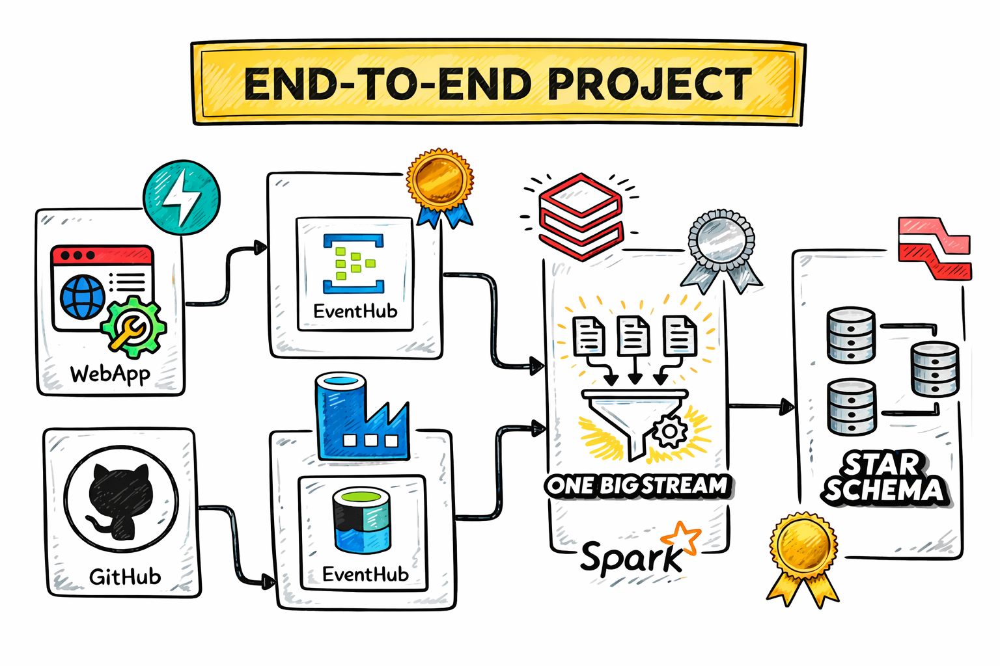

# Uber Real-Time Data Engineering Pipeline

An end-to-end data engineering learning project focused on ingesting, processing, transforming, and organizing Uber ride data using Microsoft Azure, Azure Databricks, and PySpark.

## Project Overview

This project demonstrates a data engineering workflow for processing Uber ride data through batch and streaming data pipelines.

The pipeline uses Azure services for data ingestion and storage, while Databricks and PySpark are used for data transformation and analytical processing.

## Technology Stack

- **Azure Event Hubs:** Event ingestion
- **Azure Data Factory:** Data orchestration and pipeline activities
- **Azure Data Lake Storage Gen2:** Data storage
- **Azure Databricks:** Data processing
- **PySpark:** Data transformation
- **Delta Lake:** Data storage and processing
- **SQL:** Data querying and analysis
- **GitHub:** Version control

## Project Architecture

The project follows an end-to-end data engineering architecture involving data ingestion, storage, processing, and analytical modeling.

## Data Engineering Workflow

### 1. Data Ingestion
- Collect Uber ride-related data.
- Use Azure Event Hubs for event ingestion.
- Organize the ingestion workflow using Azure Data Factory.

### 2. Data Storage
- Store incoming data in Azure Data Lake Storage Gen2.
- Organize data for further processing.

### 3. Data Processing
- Use Azure Databricks and PySpark for data transformations.
- Perform data cleaning and preparation.
- Process batch and streaming data where implemented.

### 4. Medallion Architecture
Organize processed data into three layers:

- **Bronze:** Raw ingested data.
- **Silver:** Cleaned and transformed data.
- **Gold:** Business-ready analytical data.

### 5. Analytical Data Modeling
- Work with fact and dimension tables.
- Organize data into analytical models.
- Prepare transformed data for reporting and analysis.

## Key Learning Outcomes

- Understanding end-to-end data engineering workflows.
- Working with Azure data services.
- Building data ingestion and orchestration workflows.
- Using PySpark for data transformation.
- Understanding batch and streaming processing.
- Implementing the Medallion Architecture.
- Understanding analytical data modeling.

## Project Setup

1. Clone or download this repository.
2. Review the project files and dependencies.
3. Configure the required Azure services and credentials securely.
4. Set up the Databricks environment.
5. Follow the project scripts and notebooks to execute the workflow.

## Original Learning Resource

This project is based on the following educational tutorial:

[Uber Real-Time Data Engineering Project – YouTube Tutorial](https://youtu.be/5KIbhHo6GJA)

Original tutorial and project reference: Ansh Lamba.

This repository is a customized learning implementation. Please refer to the original resource for the tutorial and acknowledge the original author appropriately.

---

**Author:** Rahul Soni

**Domain:** Data Engineering

**Technologies:** Azure | Databricks | PySpark | SQL | Delta Lake

